<p align="center">
  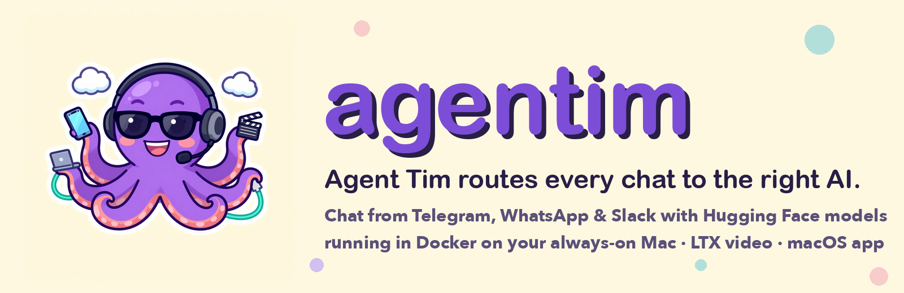
</p>

<p align="center">
  <b>Chat with your AI agents from Telegram, WhatsApp and Slack.</b><br>
  Agent Tim, a secret-agent octopus on a switchboard, plugs every message into the right model:<br>
  private Hugging Face models in Docker on your always-on Mac, LTX video, and cloud models when you want them.
</p>

<p align="center">
  Powered by <a href="https://tryperdiem.com"><b>Per Diem</b></a> (tryperdiem.com)
</p>

<p align="center">
  <a href="https://crewos-agentim.github.io/agentim/"><b>Website</b></a> ·
  <a href="#-quick-start">Quick start</a> ·
  <a href="#-how-it-works">How it works</a> ·
  <a href="#-the-mac-app">Mac app</a> ·
  <a href="#-skills">Skills</a> ·
  <a href="CONTRIBUTING.md">Contributing</a>
</p>

<p align="center">
  <a href="https://github.com/CrewOS-Agentim/agentim/actions"></a>
  
  
  
  
  
</p>

---


### 🐙 Meet Agent Tim

`agent·im` → **Agent Tim**. He's an octopus, so he has eight arms for eight jobs:

- 💬 answers you on **Telegram, WhatsApp and Slack**, in text or 🎙️ **voice notes**
- 🤗 runs **Hugging Face models in Docker** on your own Mac, after checking they fit in memory
- 🧭 **routes every message**: quick question → small fast model; code → coder model; secrets → never leave your Mac; "make a video" → LTX
- 💡 **Pitch an idea in a group chat**: Chats → New chat → *Pitch an idea*: Agent Tim asks 10 questions (5 YC partner, 5 co-founder, one at a time, with AI suggestions), then your leadership agents talk it through with each other, each on its own model
- 🧲 **Recruiter**: finds engineers from their GitHub repos and commits and drafts a personal LinkedIn message you send yourself
- 🤖 **Claude without an API key**: Opus, Sonnet and Haiku through your Claude login (`claude -p` in tmux)
- 🪄 comes with **built-in skills**: Validate Your Startup, YouTube Channel Creator, Software Engineer, Product Manager, Project Manager, Video Director, Web QA, Mobile QA, API Testing, Data Analytics, AWS DevOps, Business Development, Product Designer, Brand Designer, Recruiter
- 👔 a full **C-suite of agents** (CTO, CPO, CMO, CRO, CFO, COO, CISO, CHRO, CDO, CCO, CLO, CAIO) that also sit in your startup meetings
- 🐞 ships **agents with their own cartoon avatars** (made locally with LTX), including a **QA Engineer** that tests web apps, mobile apps and APIs and a **Data Analyst** that sets up your metrics
- 🎬 **makes videos** with LTX Desktop, locally and for free, and sends them back to your chat
- 🔌 **stays up**: the lid closes, the Mac is on the charger, and Tim is still answering. Anything that stops gets started again.
- 🖥️ ships with a **native macOS app** (Swift/SwiftUI) whose onboarding installs Docker and your models for you
- 🔗 **plugs into Claude and ChatGPT** as a connector (MCP), so they can use your local models, agents, LTX and startups
- ☁️ and if you *want* the cloud, Claude, GPT and Gemini plug in too

<br clear="right">

## 🚀 Quick start

### The easy way: let Agent Tim set himself up

Open the Mac app and the onboarding does the rest:

1. **Docker:** if it isn't installed, agentim downloads Docker Desktop and installs it for you.
2. **Pick your models.** Every option shows its real download size and whether it fits in Docker's memory. The best fit is pre-selected.

   | | Options |
   |---|---|
   | 💬 **Chat** | Qwen3 1.7B · Llama 3.2 3B · **Qwen3 4B** · Gemma 3 12B · Qwen3 14B · Qwen3 30B |
   | 🧑‍💻 **Coding** | use the chat model · Qwen2.5 Coder 1.5B / **7B** / 14B · Qwen3 Coder 30B |
   | 🎙️ **Voice** | off · Whisper Base / **Small** / Large v3 Turbo, each + Kokoro |
   | 🎬 **Video & images** | **LTX Desktop** · skip |

3. **Install.** It sets up the Docker stack (shipped inside the app) and starts the containers. Then it downloads your models with live progress, installs the restart watchdog and connects everything.

<p align="center">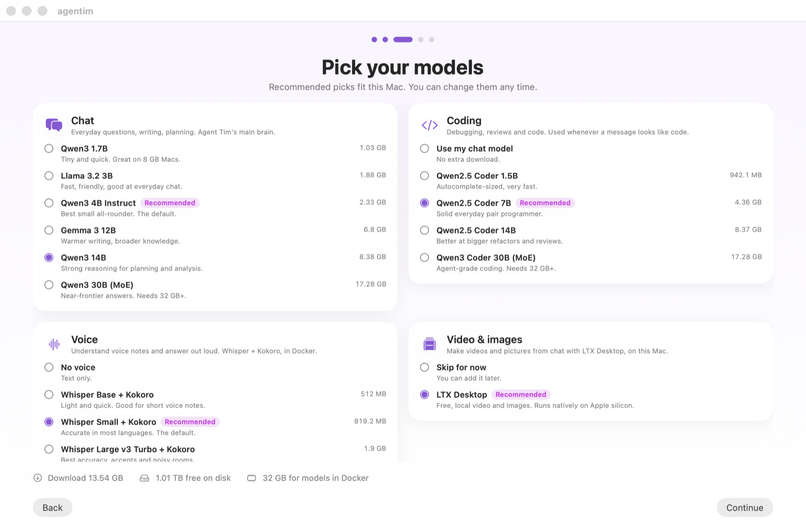</p>

```sh
brew install xcodegen
xcodebuild -downloadComponent MetalToolchain   # once; MLX needs it
xcodegen generate && open agentim.xcodeproj     # ⌘R. Onboarding opens on first launch
```

### The terminal way

You need a Mac with Apple silicon, [Docker Desktop](https://www.docker.com/products/docker-desktop/), and five minutes.

```sh
git clone https://github.com/CrewOS-Agentim/agentim.git && cd agentim

# 1. Always-on: creates .env with fresh secrets, installs the restart watchdog,
#    the LTX runner and the lid-close power guard (asks for your password once)
./deploy/macos/install.sh

# 2. Add your Telegram bot token (from @BotFather) and/or Slack tokens,
#    plus who's allowed to talk to Tim
open -e .env

# 3. Start everything. Hugging Face models download on first start.
docker compose up -d
```

Then message your bot: `/help`, `/agents`, `/validate-your-startup an app for…`, `/video a cat surfing at sunset`.

**WhatsApp:** open <http://localhost:3000/dashboard> and scan the QR code with *WhatsApp → Linked devices*.
**Who can talk to Tim:** strangers only get a polite "who are you?" with their id. Add `channel:id` pairs to `AGENTIM_ALLOWED_USERS`.

<details>
<summary><b>Getting Telegram and Slack tokens</b></summary>

- **Telegram:** chat with [@BotFather](https://t.me/BotFather) → `/newbot` → paste the token into `TELEGRAM_BOT_TOKEN`.
- **Slack:** [create an app](https://api.slack.com/apps):
  - turn on **Socket Mode** and create an app token (`xapp-…`, scope `connections:write`) → `SLACK_APP_TOKEN`
  - give the bot the scopes `app_mentions:read chat:write files:write im:history im:read`
  - subscribe to the bot events `app_mention` and `message.im`
  - install the app, then copy the bot token (`xoxb-…`) → `SLACK_BOT_TOKEN`

  No public URL is needed, for Slack or Telegram.
</details>

## 🧠 How it works

```
 Telegram ─┐                    ┌──────────────── your Mac ────────────────┐
 WhatsApp ─┼──► gateway ──► router ──► runner ──► Ollama (Hugging Face GGUF, Docker)
 Slack ────┘    agents          │        │   └──► memory check before every pull
                skills          │        └──────► LTX Desktop (video/image, native)
                history         └──► Claude / GPT (optional; never for sensitive prompts)
```

| Piece | What it is | Where |
|---|---|---|
| **gateway** | Connects Telegram (long polling), Slack (Socket Mode) and WhatsApp (WAHA bridge) to agents, skills, per-chat memory and the router. | [`gateway/`](gateway) · Python, in Docker |
| **runner** | One OpenAI-compatible API over Ollama, LM Studio, llama.cpp, vLLM and Docker Model Runner. Reports host memory, **refuses models that won't fit**, and bridges LTX Desktop. | [`runner/`](runner) · Python, standard library only |
| **models** | Hugging Face GGUF builds served by Ollama in Docker. Defaults: Qwen3-4B-Instruct-2507 and Llama 3.2 3B (Q4_K_M), memory-checked before download. | [`docker-compose.yml`](docker-compose.yml) |
| **always-on** | A watchdog restarts Docker and the stack, a power guard disables lid-close sleep *only on the charger*, and the Mac boots again after a power cut. | [`deploy/macos/`](deploy/macos) · [`deploy/linux/`](deploy/linux) |
| **Mac app** | A native SwiftUI app: chats, agents, skills, models, on-Mac MLX models, and the **This Mac** control center, plus a menu bar icon. | [`AgentHub/`](AgentHub) · Swift |

### The router

Each message is classified (code, reasoning, writing, quick, long context, video, image, sensitive) and sent to the best model you have. **Local models are preferred by default.** The order of precedence is:

1. `@alias` in the message (`@qwen3-4b-instruct-2507 explain this`)
2. the model pinned to the chat (`/model <alias>`)
3. the model pinned to the agent
4. sensitive-looking prompts (passwords, medical, card numbers…) go to a local model
5. "make a video/image" goes to LTX; text never goes to media models
6. the best score for the task, weighed by quality, cost and your *economy / balanced / quality* setting

If a model fails, the next one in the ranking answers. Every reply says which model answered and why.

### Memory check

Before any download, the runner looks up the real file sizes from the Ollama registry or Hugging Face. It then estimates the memory needed: weights × 1.2 + 512 MB. The verdict depends on how that compares with the machine:

| Verdict | When | Pull |
|---|---|---|
| `fits` | it fits in the memory free right now | allowed |
| `tight` | it fits the machine, but not with what's free now | allowed, with a warning |
| `too_large` | it's bigger than one model may use (about 75% of RAM on Apple silicon) | refused (HTTP 409) |
| `not_enough_disk` | there isn't enough free disk space | refused (HTTP 409) |

## 🖥 The Mac app

**Claude through tmux, not the API (the default).** In **Settings → Claude**, choose *Your Claude login, in a background terminal (tmux)* or *An Anthropic API key* (`AGENTIM_CLAUDE_VIA=tmux|api`). In tmux mode the Anthropic API is never called, even if a key is saved; Settings shows whether Claude Code and tmux are installed (tmux is installed for you), how many Claude sessions are running, and **Watch in Terminal** opens the latest one.

**Claude without an API key.** If Claude Code is installed, agentim uses your Claude login: **Claude Opus, Sonnet and Haiku** run through `claude -p` (read-only, in an empty folder, so plain chats never read your code), each in a **tmux** session you can watch (`tmux ls`, `tmux attach -t agentim-…`; tmux is used automatically when it's installed, `AGENTIM_LOCAL_AGENTS_TMUX=0` turns it off). They're real models: routing can pick them, any agent can be set to one, and `@sonnet` asks one directly. They use your Claude plan's limits; set `AGENTIM_CLAUDE_LOGIN=explicit` to use them only when you pick them (background work then stays on local models).

**Claude and ChatGPT, everywhere.** Two ways, both supported by the app *and* the gateway (startups, Telegram, WhatsApp, Slack): **API keys**, where a Claude or OpenAI key you save in Settings is shared with the gateway automatically (Claude Opus/Sonnet/Haiku 5.5, GPT-5, GPT-5 mini), or **your local logins**, Claude Code and Codex (ChatGPT) on your Mac, which answer whenever no other model is running. You can always ask for one by name: `@opus`, `@gpt5`, `@claude-code`, `@codex`. And agentim works *inside* Claude (connected automatically) and ChatGPT (the connector button in This Mac).

**It starts everything for you.** When the app opens it makes sure agentim is ready: it starts Docker Desktop and any stopped agentim container, adds this Mac's runners, turns on the coding agents you have installed (**Claude Code**, and **Codex** for ChatGPT), connects agentim to Claude, waits for the models to answer and preloads your default chat model so the first reply is quick (the status bar shows *Starting your models…*). It keeps re-checking every 10 seconds while something is offline. If no local chat model is up, chats are answered by **Claude Code** on your Mac (then Codex) instead of failing with "No model is available". The ChatGPT web connector isn't opened automatically, because it makes agentim reachable from the internet: that stays a button in **This Mac**.

<p align="center">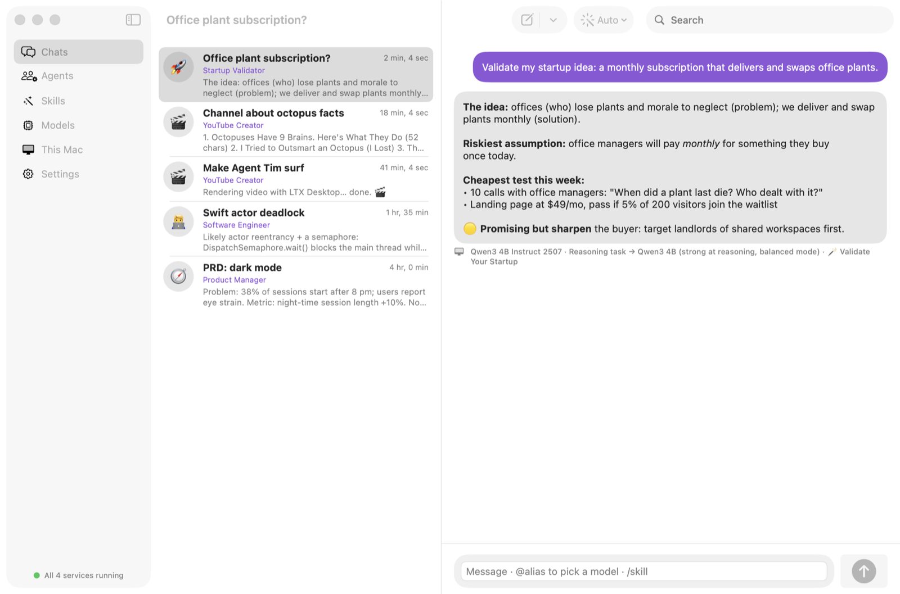</p>
<p align="center"><b>Chats</b>: a roomy message box (Enter sends, Shift+Enter for a new line), drag in files, and every reply says which model answered and why</p>

<table>
  <tr>
    <td>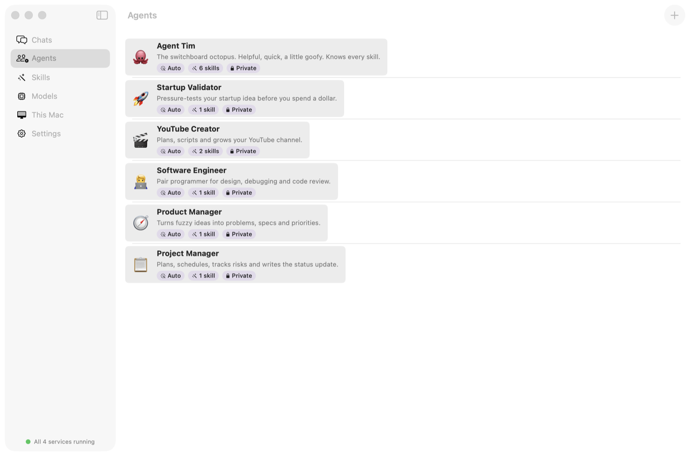</td>
    <td>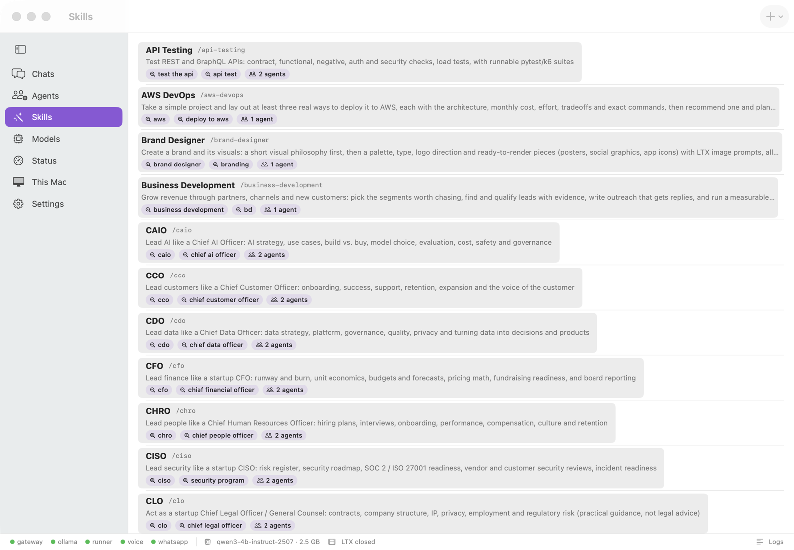</td>
  </tr>
  <tr>
    <td align="center"><b>Agents</b>: each with its own avatar, skills and model preference</td>
    <td align="center"><b>Skills</b>: QA, data analytics, startup, product, video and more</td>
  </tr>
  <tr>
    <td>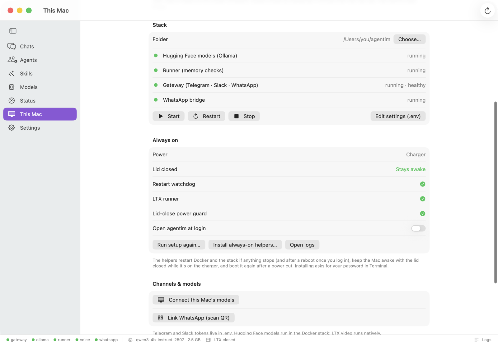</td>
    <td>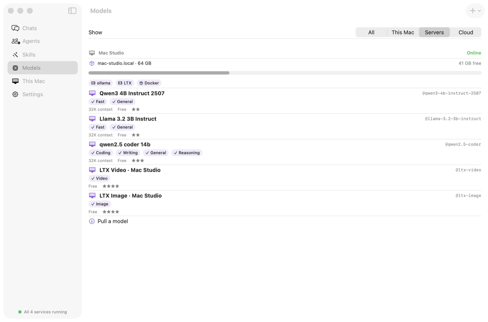</td>
  </tr>
  <tr>
    <td align="center"><b>This Mac</b>: start the stack, keep it awake, connect Claude and ChatGPT</td>
    <td align="center"><b>Models</b>: Hugging Face in Docker, LTX, on-Mac MLX, cloud</td>
  </tr>
</table>

```sh
brew install xcodegen
xcodebuild -downloadComponent MetalToolchain   # once; MLX needs it
xcodegen generate && open agentim.xcodeproj     # ⌘R
```

The app can also run Hugging Face **MLX** models directly on your Mac's GPU, after the same memory check. Use **Models → Browse Hugging Face**.

**Status bar and logs:** a bar at the bottom of every screen shows each container from `docker ps` (green = running), the models in memory and LTX; click any of them, or **Logs**, to open the Logs window for that container or for the runner on your Mac, live, with a filter, copy, **Open in Terminal**, and the app's own status checks hidden.

**Quick controls:** **This Mac** has one-click **Start / Restart / Stop** for all the Docker containers, shows which models are in memory, and **Free memory** unloads them now (they also unload by themselves 5 minutes after their last use, `OLLAMA_KEEP_ALIVE`). **Stop LTX** quits LTX Desktop to free its GPU memory; it opens again when you ask for a video or image. The same actions are in the menu bar.

**More room:** the left navigation collapses to an icon rail (the sidebar button, or ⌃⌘S), the startups list hides from the toolbar, and the plan hides behind **Plan**.

**Group chats:** **New chat → Group chat** starts an ad-hoc chat with any mix of agents *and* skills (say CTO, CMO and the Web QA skill; a skill joins as its own member and answers with its playbook). Tap members in to pick them, then type. Every member answers in turn, each building on the others, with their name in their own color, grouped bubbles and "… is typing"; tag `@CTO` (or a skill's `@slug`, Tab completes) to ask just one. Add or remove members from the header any time.

**Let them talk to each other.** In a group chat, the **Discussion** menu sets what happens after your message: each member answers once, **2 or 3 rounds** where they reply to *each other* (building on or pushing back on what was said, working toward what you asked for), or **until they agree** (a member with nothing to add passes; it ends when everyone passes, max 5 rounds). Great for writing together: ask for a launch post and let the copywriter, the skeptical editor and the CMO argue it into shape. Every member can **think with its own model** (click their chip), or turn on **A different model for each member** to divide the available models automatically; each reply shows the model that wrote it. **Add → New persona…** creates a quick persona (a name plus who they are and how they write) right in the chat.

**Status:** the **Status** page shows which models are running, your Mac's CPU and memory (with live charts), each container's CPU and memory (`docker stats`), and every model task: what's running now and a history with timings and results.

**Chatting:** a roomy message box that grows as you type; press **Enter** to send (**Shift+Enter** for a new line). **Drag files** into a chat, or click 📎: text, code and PDFs are read into the prompt (up to 10 files, 20 MB and 100k characters each); images and other files are passed by name, since the chat models only read text.

**Found a bug?** **Help → Report an Issue on GitHub…** (also in Settings and the menu bar) opens a new GitHub issue with your app version, macOS, chip and memory filled in. Nothing is sent until you submit it.

## 🔗 Use agentim from Claude & ChatGPT

agentim is also an [MCP](https://modelcontextprotocol.io) server, so Claude and ChatGPT can add it as a connector. They get 11 tools:

| Tool | What it does |
|---|---|
| `ask_agentim` | Answer with your local models (auto-routed), an agent, `@model` or a `/skill` |
| `generate_image`, `generate_video` | Make media with LTX on your Mac (opens LTX Desktop if needed) |
| `list_agents`, `list_skills`, `list_models` | See what's available |
| `list_startups`, `get_startup`, `create_startup`, `answer_startup_questions`, `run_startup_meeting` | Run Startup Mode from the chat |

**Claude Desktop and Claude Code** (stays on your Mac): **This Mac → Add to Claude** in the app, or

```sh
~/Library/Application\ Support/agentim/stack/deploy/macos/connect-claude.sh   # then restart Claude
```

It adds a local server (`deploy/mcp/agentim_mcp.py`) that talks to the gateway on localhost with your token.

**ChatGPT** needs an HTTPS address it can reach, so agentim opens a temporary [Cloudflare quick tunnel](https://developers.cloudflare.com/cloudflare-one/connections/connect-networks/do-more-with-tunnels/trycloudflare/): **This Mac → Connect ChatGPT**, or

```sh
~/Library/Application\ Support/agentim/stack/deploy/macos/connect-chatgpt.sh        # prints the connector URL
~/Library/Application\ Support/agentim/stack/deploy/macos/connect-chatgpt.sh stop   # closes it
```

In ChatGPT: **Settings → Apps & Connectors → Advanced → Developer mode**, then **Create**, paste the URL and pick **No authentication**. The URL ends in a long random secret (`AGENTIM_MCP_SECRET`) and is the key to your agentim, so keep it private. A quick tunnel gets a new address each time it starts.

Any other MCP client can use `POST http://localhost:8780/mcp` with `Authorization: Bearer <AGENTIM_API_TOKEN or RUNNER_TOKEN>`.

## 🪄 Skills

Skills are plain `SKILL.md` files in [`gateway/skills/`](gateway/skills). They're shared by the gateway and the Mac app. An agent uses a skill when a message contains one of its trigger words, or when anyone types `/skill-name`.

| Skill | Try |
|---|---|
| 🚀 **Validate Your Startup**: problem, customers, market math, riskiest assumption, a <$100 test | `/validate-your-startup Uber for dog walking` |
| 🎬 **YouTube Channel Creator**: niche, names, calendar, titles, thumbnails, hooks | `/youtube-channel-creator cooking for students` |
| 🧑‍💻 **Software Engineer**: debugging, design trade-offs, reviews with the bugs first | `/software-engineer why does this deadlock?` |
| 🧭 **Product Manager**: one-page PRDs, RICE, metrics | `/product-manager PRD for dark mode` |
| 📋 **Project Manager**: plans, critical path, risks, status updates | `/project-manager plan a launch in 6 weeks` |
| 🎥 **Video Director**: idea → on-model shot prompts → LTX clips | `/video-director a 20 s teaser for my app` |
| 🌐 **Web QA**: risk-based test plans, Playwright tests, accessibility, flaky-test hygiene, bug reports | `/web-qa test the checkout on staging.example.com` |
| 🤝 **Business Development**: segments and partners worth chasing, leads qualified with evidence, outreach drafts for a human to send, a measurable pipeline. Also an agent. | `/business-development find 20 partners for a booking app` |
| 🎨 **Product Designer**: the user and their job first, a small token system and wireframes before pixels, one bold idea instead of a template, accessibility as the floor | `/product-designer design onboarding for a dog-walker app` |
| 🖌️ **Brand Designer**: a visual philosophy first, then palette, type, three logo directions, posters and social posts with LTX prompts to render them locally | `/brand-designer a brand for a neighborhood coffee newsletter` |
| ☁️ **AWS DevOps**: reads a simple project and lays out at least 3 ways to deploy it to AWS (static, serverless, containers, managed platform…), each with architecture, monthly cost, effort, tradeoffs and exact commands; then recommends one and plans CI/CD (GitHub Actions + OIDC), security, monitoring and rollback. Also an agent: **AWS DevOps**. | `/aws-devops my Express API + React app with Postgres, 200 users a day` |
| 📱 **Mobile QA**: device matrix, Maestro/XCUITest/Espresso flows, interruptions, offline, store readiness | `/mobile-qa test our iOS onboarding` |
| 🔌 **API Testing**: contract, negative and OWASP API Top 10 checks, pytest + httpx suites, k6 load tests | `/api-testing here's our openapi.yaml` |
| 🧠 **CTO** · 🧭 **CPO** · 📣 **CMO** · 💼 **CRO**: tech, product, marketing and revenue leadership playbooks | `/cro build our Q3 revenue plan` |
| 🛡️ **CISO** · 💰 **CFO** · ⚙️ **COO**: security program, runway and unit economics, OKRs and operating rhythm | `/cfo how long is our runway?` |
| 🫂 **CHRO** · 🗄️ **CDO** · 🤗 **CCO**: hiring and culture, data platform and governance, customer success and retention | `/chro plan our next 5 hires` |
| ⚖️ **CLO** · 🤖 **CAIO**: contracts, IP and privacy (not legal advice); AI strategy, evaluation and governance | `/caio which AI features should we ship?` |
| 📊 **Data Analytics**: north star, funnel, retention, tracking plan, dashboards, SQL, experiments | `/data-analytics what should we measure?` |

Adding your own is as easy as dropping a markdown file in that folder:

```markdown
---
name: Release Notes
description: Turn a changelog into release notes people read
triggers: release notes, changelog
---
Group changes by user benefit, lead with the biggest one, keep it under 200 words.
```

## 🚀 Projects

> **In the Mac app, ideas now start in Chats.** Choose **New chat → Pitch an idea (group chat + 10 questions)**: describe the idea, answer Agent Tim's 10 questions one at a time (**Back / Skip / Next**, **✨ Suggest an answer**, **Let AI answer the rest**), and your leadership agents (CPO, CTO, CMO, CRO, CFO, whichever you have) discuss it with each other in rounds, with your answers as the group's brief. The project engine below (worth-building check, graphs, launch, hiring) still runs in the gateway and is used from Telegram/WhatsApp/Slack (`/startup`), the HTTP API and Claude/ChatGPT (MCP); it no longer has its own screen in the Mac app.

Run **as many startups as you like**, each with its own team of agents who act like real employees.

1. **Pitch it.** Write the pitch in the Mac app (Startups → New startup) or in any chat: `/startup new <your pitch>`.
2. **Get interviewed.** Agent Tim asks **10 follow-up questions**: five as a 🟧 *YC partner* (who desperately needs it, how do you know, why now, what's the insight, how you make money) and five as a 🤝 *co-founder* (why you, commitment and runway, roles, the first 90 days, kill criteria). They come from the `yc-partner` and `co-founder` skills; swap in your own with `AGENTIM_STARTUP_SKILLS`. In the Mac app they come one at a time, with **Back**, **Skip** and **Next** (Return moves on), and a progress bar. Not sure what to say? **✨ Suggest an answer** has the AI draft one from your pitch and your other answers (edit it, then Next), and **Let AI answer the rest** fills every blank question (marked *suggested by AI*, so the agents know it's a guess) and starts the team.
3. **The agents get to work.** Every 10–30 minutes, at a random time, the team of agents meets. You can watch the meeting live in the **Agents room**: who's in it, who's typing, and each message as it lands. Their standing goals: **launch fast, measure, improve**; sales and marketing grow revenue and weekly active users; design ships one improvement every meeting; and Nina (Data Analyst) reports the numbers. The people who spoke least recently report what they did, propose next moves in their own area, and ask colleagues for help by name ("@Leo, can you mock the ROI page?"). Tim (CEO) updates the living plan and sends you a two-line summary in your chat.

| | The team |
|---|---|
| 🧭 Maya Chen, CPO | 🎨 Leo Park, Designer · 🛠️ Noah Patel, CTO |
| 📣 Ava Brooks, CMO | ⚙️ Sam Rivera, Marketing Automation · 💼 Zoe Kim, CRO |
| 🤝 Omar Haddad, Business Development | 💰 Grace Liu, CFO · 📊 Nina Shah, Data Analyst |
| 🛡️ Dana Cohen, CISO | ⚙️ Marcus Reed, COO |
| 🐙 Agent Tim, CEO | |

```
/startup new Leafy: a monthly subscription that swaps office plants   ← pitch (then answer Tim's 10 questions)
/startup        ← your startups      /startup 2   ← plan of #2      /startup now 2   ← meet right away
/startup off 2  ← pause              /startup on 2                   /startup delete 2
```

**Talk to your agents.** Type in the agents room (or `/startup say <n> <message>` in chat). During a meeting, the agents who speak next answer you first; between meetings, the next one starts from your message. **Tag someone** with `@`: "@Sam come up with 2 designs for the welcome email" and Sam answers right away. Typing `@` suggests your agents.

**Review every meeting.** The **Meetings** tab lists each meeting with its date and time, who was there and Tim's summary; open one to read the whole conversation.

**Link your code.** A startup can point at local folders and GitHub repos (`owner/name`, cloned on your Mac): every meeting starts with a short brief of each codebase (README, structure, stack, recent commits), so the agents improve what's really there.

**Launch it: design → code → test → deploy → live.** Every startup and idea has a **Launch** tab with its own settings: the project folder (created for you if there's no code yet), the stack, the test command, where to deploy (Vercel, Netlify, Cloudflare Pages, Fly.io, Docker on this Mac, or your own command) and the live URL. Then the pipeline really ships it:

| Stage | What happens | Needs your OK |
|---|---|---|
| 📐 Design | Claude Code designs v1 from the team's plan: screens, look, data model, stack, files. Read-only. The team meets on it. | No |
| 🛠️ Build | Claude Code writes the code in the project folder, adds tests and a README, and reports the test command. | Yes |
| 🧪 Test | Your test command runs; if it fails, Claude Code gets one try to fix it (without weakening the tests). | Part of the build |
| 🚀 Deploy | Your deploy command runs with your own CLI login (`vercel`, `netlify`, `fly`…); the live URL is read from its output. | Yes |
| 🌍 Live | agentim checks the URL answers, posts it in the agents room, and the team meets to plan the launch. | No |

Every step reports in the agents room, and the agents see where the launch stands in every meeting. agentim never stores deploy secrets (your CLIs keep their own logins), and only works in folders you picked.

**Versions and GitHub.** Every build (and every launch-mode run) becomes a version: agentim commits the project with a Conventional Commit message (`feat: build v1 of Leafy`, `feat: update Leafy`, `fix: …`), tags it **v0.1.0, v0.2.0…** (patch bumps for fixes) and adds it to `CHANGELOG.md`, newest first, with what changed and whether the tests passed. The Launch tab's **Code & versions** list shows each version, its message, time and commit. After the first version, Tim suggests a GitHub repo: **Create GitHub repo…** makes one with your own `gh` login (**private** by default) and pushes every version and tag so far; you choose whether new versions are pushed automatically, or press **Push** when you want. agentim never creates a repo or pushes without your click, and never force-pushes. Versioning is automatic in folders agentim created; in your own folders it's off unless you turn it on (so your work in progress is never swept into a commit).

**⚡ Launch mode: everyone at once.** Press **Launch mode** on a startup (you confirm, since it writes code) and the meeting rhythm is skipped: Claude Code designs v1 while *every* employee delivers their part of the launch at the same time, finished and ready to use:

| Who | Delivers |
|---|---|
| CPO | v1 scope, activation event, success metric |
| Designer | landing page and key screens, colors, fonts, onboarding |
| CTO | stack, data model, routes, analytics events |
| CMO | landing copy, LinkedIn and X launch posts, Show HN / Product Hunt blurb |
| Marketing Automation | welcome email sequence and the activation funnel |
| CRO | pricing, outreach messages, 20 target customers, objection answers |
| BizDev, CFO, Data, CISO, COO | launch partners, unit economics, tracking plan, security checklist, launch-day run sheet |

Then Claude Code builds the product **with** that launch kit (the CMO's copy on the landing page, the tracking plan instrumented) and saves the marketing assets under `launch/` in the project, the tests run, and the team holds a wrap-up meeting with action items. Deploying stays a separate confirmation, and nothing is posted to social networks: the posts and emails are ready for you to send. Ollama runs up to 4 requests at once (`OLLAMA_NUM_PARALLEL`, default 4) so the agents really work in parallel. API: `POST /v1/startups/{id}/sprint {"confirmed": true}`.

**Start with the goal, and check it's worth building.** **New project** asks one thing: *what's the goal?* It can be a **new idea**, a **new project** to build, or a **feature for your existing code**. Before anyone builds, the team checks it's worth it: who already solves this (companies, products, open source, with prices), **build vs buy**, and the gap no one fills. With Claude Code on your Mac this is real research with web search; otherwise it's the model's knowledge, and the card says which. A "build" verdict starts the work. "Buy", "build on top" or "stop" waits for your call: **Build anyway** or **Stop**.

**Harness, loops and graphs** (after *Harness, Loops, Graphs: what each layer fixes*). By default a project runs as **one continuous meeting** with no scheduled rounds; you get a **summary on demand** (the **Summarize** button):
- **Harness**: the team's **memory** (your rules, the decisions, lessons) lives outside any one chat and goes into every agent's brief; permissions stay tight.
- **Graph**: set a goal and Agent Tim turns it into a **graph of tasks** with dependencies. Tasks that don't need each other run **in parallel**; each starts from the results it depends on, and passed work is frozen. **Gates follow the cost of undoing**: *auto* (cheap), *checked* (Tim reviews), *code* (Claude Code changes the project and the tests check it), *you approve* (anything public, sent to customers, money or a deploy).
- **Loop**: every task has a **"done when"** (evidence that can fail). Agent Tim checks each result, **on a different model than the one that did the work**. A fail goes back with the specific reason, and the agent tries again (max 2 retries). Then it's **blocked** and comes to you: give a hint and retry, send it back, or cancel.
- **Learning**: a task that fails its check twice leaves a **lesson** in that role's memory, so the same mistake doesn't come back.
- **Different models**: each agent can think with its own model (set it in **Agents**: any local model, Claude, ChatGPT, or Claude Code/Codex on your Mac); by default coders get the best coding model.
- **Autopilot** (a switch per project): the team keeps going, goal after goal, until Agent Tim judges the project developed. Coding tasks are done by **Claude Code in the project folder**, your tests are the proof, and each passing change becomes a version. Deploys, public posts, customer emails and spending still wait for you. Limits per rolling 60 minutes: `AGENTIM_AUTOPILOT_GOALS_PER_HOUR` (3) and `AGENTIM_TASKS_PER_HOUR` (20).
- Talk to the room any time: Agent Tim answers, and a new goal ("goal: get 10 pilot customers") becomes a new graph. Prefer meetings? Switch a project to *Meetings → handoffs* or *Meet every 10–30 min*.

**Hiring: a Recruiter that reads code.** Each project has a **Hiring** tab (and a **Recruiter** you can add to the team, or chat with in Agents). Describe the role ("Senior iOS engineer, Swift, Europe"); the Recruiter turns it into a GitHub search, reads each person's public profile, recent repos and recent commit messages (with your `gh` login), scores the fit from that evidence, and drafts a **LinkedIn connection note** (≤ 280 characters) and a longer message that mention something they actually built. You review each one: edit, **Copy**, **Find on LinkedIn**, **Open GitHub**, and track *shortlisted → contacted → replied*. **You send the messages yourself**: GitHub's terms don't allow using information from GitHub (such as commit emails) for unsolicited outreach, recruiters included, and LinkedIn doesn't allow automated messaging, so agentim never collects emails and never sends anything.

**Shared, fair model time.** Background work (agents working, checks, ETA questions, meetings) shares 2 model slots across every project (`AGENTIM_BACKGROUND_PARALLEL`), so what you're waiting for (interviews, replies, plans, 1:1s) never waits behind it.

**Agent Tim runs the loop, in minutes.** Every minute Tim checks each project: he restarts ready work nobody picked up, **asks each owner for an ETA in minutes** ("Zoe: ~25 min for the pricing page"), chases anything past its ETA for a new one (after 3 slips you hear about it), reminds you about approvals, and posts a **summary every 120 minutes** when something changed (`AGENTIM_SUMMARY_EVERY_MINUTES`; also sent to Telegram/WhatsApp/Slack). The Graph tab shows a **Gantt chart in minutes**: each task's planned bar (from the first ETA, after what it waits for) and its actual or forecast bar, with a line at *now*. **Nothing runs on days**: budgets are per rolling 60 minutes (`AGENTIM_TASKS_PER_HOUR` 20, `AGENTIM_AUTOPILOT_GOALS_PER_HOUR` 3) and ETAs are in minutes.

API: `POST /v1/startups/{id}/goal`, `/summary`, `/decision {"decision": "build"|"stop"}`, `/check`, `/memory`, `/tasks {"approve"|"reject"|"retry"|"cancel": id}`.

**Work flows by handoffs, not by the clock.** A meeting's action items become tasks on the startup's **Work** board (owner, ETA, and what each waits for: *after Leo's ROI page*). An agent starts as soon as a task is ready (up to 3 at a time), delivers the actual result (the copy, numbers, plan or checklist), and **hands off** to whoever continues from it ("@Sam: put this ROI page in the welcome email"), which starts Sam right away with Leo's result as input. When the board is empty, the team meets (after the startup's minimum break) to plan the next tasks. You can assign anyone a task from the Work tab, and cancel ones that aren't needed. Guard rails: 20 tasks per rolling 60 minutes per project, a handoff chain stops after 4 steps, and pausing a startup pauses its work. Prefer the old rhythm? Switch the Work tab to **Meet every 10–30 min**. API: `GET /v1/startups/{id}/tasks`, `POST /v1/startups/{id}/tasks {"owner": "Ava", "task": "…"}`, `PATCH`-style `POST /v1/startups/{id} {"rhythm": "events" | "timer"}`.

**Action items with owners and ETAs, in time.** The team meets every 10–30 minutes, so plans run on minutes and hours, never days. Every meeting ends with action items, each with one owner and an ETA like *in 45 min*, *in 2 h*, *by 15:30*, or a dependency: *right after Leo's ROI page*. ETAs nobody set are marked *proposed*, and a meeting that forgot action items gives one to each person who spoke. The next meeting opens with the open items, their due times and what's **overdue**, and each owner reports done or a new ETA. They show as a table (with the due time) in the meeting notes, in Tim's summary, and as `action_items` (`eta`, `due`, `after`) in `GET /v1/startups/{id}/meetings/{n}`.

**Messages, like iMessage.** Each startup's **Messages** tab lists every conversation with avatars, the last message and its time: the **Team room** (everyone, and the meetings) pinned on top, your **groups**, and a private thread with **each employee** and Agent Tim. Press ✏️ to make a group (say *Growth*: Ava, Sam and Zoe): everyone in it answers in turn, in the first person about their own work, or `@Name` asks one. The rest of the team doesn't see groups or 1:1s, but the people in them bring what you agreed into the next meeting. The plan has its own **Plan** toggle so conversations get the space. API: `GET /v1/startups/{id}/threads`, `POST /v1/startups/{id}/groups`, `GET`/`POST /v1/startups/{id}/dm/{person or group-id}`.

**Ideas for your code.** Choose **New → Idea for my code**, describe a feature, and pick the services it touches (one folder or repo each). **Plan with Claude Code** asks your local Claude Code to plan the change in *each* service, read-only, and posts every plan in the agents room before the team meets on it. **Build it…** (after you confirm) lets Claude Code make the changes in each service and reports the changed files; it never commits or pushes. Folders you pick are added to `AGENTIM_WORKSPACES`; agentim can't read anything else.

**Make the team yours.** That's the default team: every startup can have its own (1–12 agents plus Tim). In the Mac app, click **Agents** to open the team page (full screen, no pop-up): every agent as a card, and an editor beside it to rename anyone, change their title, emoji, avatar, persona or what they own, **Add agent** from presets (CTO, Customer Success, Growth, Data, Operations, Legal, Recruiter, Community, QA Engineer, Penetration Tester, Security Researcher, Compliance & GRC) or anyone you describe, and remove agents. Agents you remove keep their messages in the agents room, marked *former*; the current team stops seeing them. In chat:

```
/startup team 2                                                    ← who works on #2
/startup hire 2 Jordan Lee | Customer Success | onboarding pilots  ← name | title | what they own
/startup fire 2 Omar                                               ← let someone go
```

<p align="center">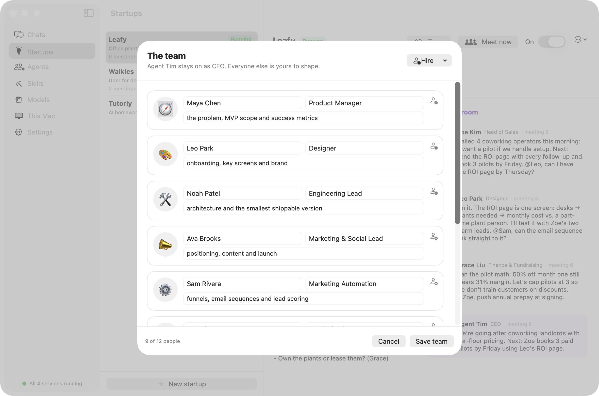</p>

It runs in the always-on gateway, so the teams keep working with the app closed, and uses your local models (routed to the strongest reasoning model you have).

<table>
  <tr>
    <td>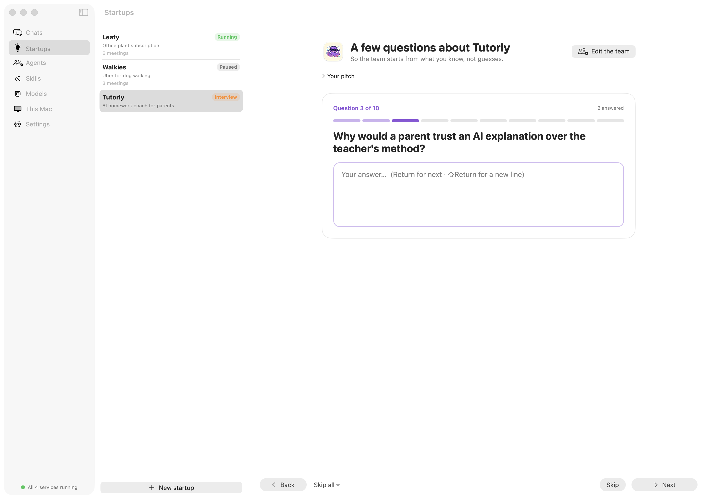</td>
    <td>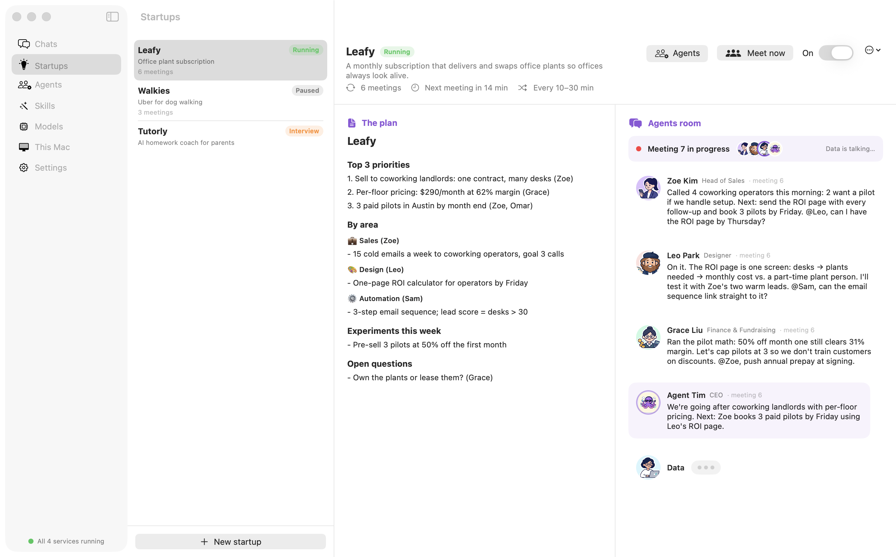</td>
  </tr>
  <tr>
    <td align="center"><b>The interview</b>: one question at a time, Back / Skip / Next</td>
    <td align="center"><b>A live meeting</b>: watch the agents talk as it happens</td>
  </tr>
</table>

<p align="center">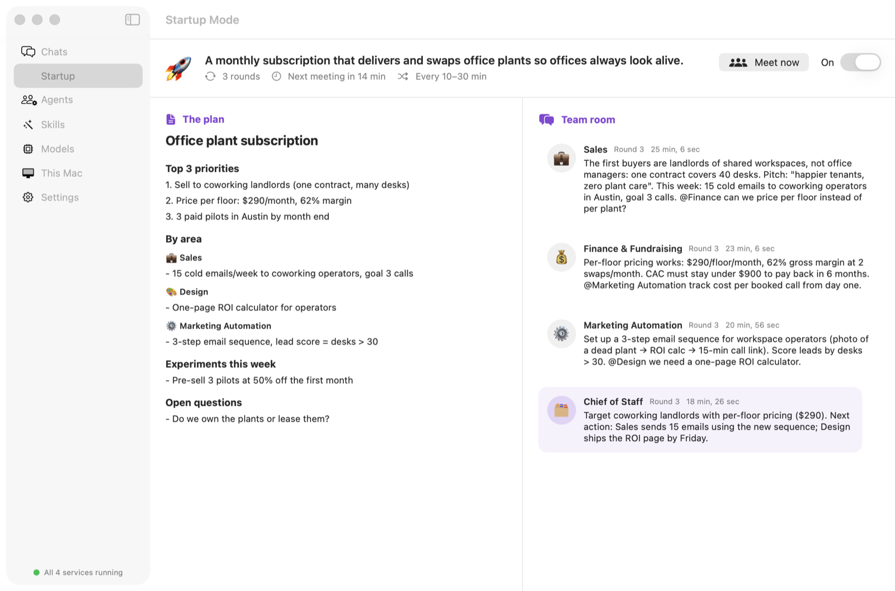</p>
<p align="center"><b>Your startups</b>: the living plan (priorities, metrics, owners) next to the agents room</p>

## 🎙️ Voice

Pick a voice model during onboarding (or set `COMPOSE_PROFILES=voice` in `.env`). The `voice` container ([Speaches](https://github.com/speaches-ai/speaches): Whisper + Kokoro) runs entirely on your Mac.

- **Send a voice note** on Telegram or WhatsApp. Tim transcribes it locally (🎙️ "…"), answers, and **replies with a voice note**. Code and links stay in the text; they aren't read aloud.
- Strangers' audio is never transcribed: the allow-list is checked first.
- Turn spoken replies off with `AGENTIM_VOICE_REPLIES=false`, or change the voice with `AGENTIM_TTS_VOICE` (e.g. `af_heart`).

## 🔐 Private skills and agents

Keep company-specific playbooks out of the open-source repo: put them in your installed stack's `private/` folder (git-ignored, mounted read-only into the gateway, and read by the Mac app):

```
~/Library/Application Support/agentim/stack/private/
├── skills/my-playbook.md      # same format as gateway/skills/*.md → /my-playbook
├── agents.json                # extra agents, same format as gateway/config/agents.json
└── avatars/my-agent.png       # optional avatar (file name = agent name in kebab-case)
```

Restart the gateway (**This Mac → Restart**) to load new ones.

## 🤖 Local coding agents (Claude Code, Codex)

Agent Tim can hand a task to the coding agents already installed on your Mac, from any chat, the Mac app, or Claude/ChatGPT through the connector:

```
@claude-code review the auth module in my-app and list the riskiest bugs
@codex explain how the build works
```

They're **off by default** and only used when a message names them (the router never picks them on its own). Turn them on in `.env`:

```sh
AGENTIM_LOCAL_AGENTS=claude-code,codex          # which ones (also: gemini, or "on" for all installed)
AGENTIM_WORKSPACES=/Users/you/code/my-app       # the only folders they may work in (":"-separated)
AGENTIM_LOCAL_AGENTS_MODE=read                  # read (default: plan/read-only sandbox) or edit
AGENTIM_LOCAL_AGENTS_TMUX=1                     # optional: watch each run with `tmux attach -t agentim-…`
```

**Your existing Claude Code sessions** work too, once Claude Code is enabled: `/claude` lists the sessions from your workspaces (newest first, with their titles), `/claude 2` shows the latest messages, and `/claude 2 now write the fix` continues that session with `claude --resume` in its own folder. From Claude or ChatGPT, use the `list_claude_sessions`, `read_claude_session` and `continue_claude_session` tools. Only sessions inside `AGENTIM_WORKSPACES` are visible, and only their conversation text (no tool output).

They run through the native runner on the Mac (the one that also drives LTX), with each tool's own safety settings: Claude Code in `plan` mode (or `acceptEdits` in edit mode) and Codex in a `read-only` sandbox (or `workspace-write`). The usual allow-list still decides who can talk to Tim at all.

## 🎬 Making videos

With [LTX Desktop](https://ltx.studio) installed on the Mac, the native runner (installed by `install.sh`) adds `ltx/video` and `ltx/image`, and the router sends "make a video of…" and "an image of…" there, from the Mac app, your chat apps, Claude or ChatGPT. If LTX Desktop is closed, the runner opens it and waits for it to load. In any chat:

```
/video a tiny purple cartoon octopus in sunglasses surfing a wave made of chat bubbles
```

Agent Tim renders it locally, for free, and sends the clip back to Telegram, WhatsApp or Slack. The clip on the [website](https://crewos-agentim.github.io/agentim/#video) was made exactly this way.

## 🔒 Privacy & security

- **Local by default.** Models run on your machine, and cloud keys are optional.
- **Sensitive prompts never go to the cloud**, even when cloud models are configured.
- **Allow-list.** Only the users in `AGENTIM_ALLOWED_USERS` get answers.
- **Tokens everywhere.** The runner and gateway APIs need a bearer token, and the WhatsApp webhook needs a secret. The WAHA dashboard is bound to localhost.
- WhatsApp uses [WAHA](https://waha.devlike.pro/), which links like WhatsApp Web. It isn't the official Business API, so use a number you're comfortable linking.

## 🧪 Tests

```sh
python3 -m unittest discover -s gateway/tests     # gateway: router, skills, channels, API
(cd runner && python3 -m unittest test_runner)    # runner: memory check, refs, LTX chat
python3 -m unittest discover -s deploy/tests      # always-on scripts and launchd plists
xcodebuild -project agentim.xcodeproj -scheme AgentHub -destination platform=macOS \
  -skipMacroValidation -skipPackagePluginValidation test   # Mac app
```

CI runs all four on every push.

## 🗺 Roadmap

- [ ] Sync agents and skills between the Mac app and the gateway
- [x] Voice notes in and out (Whisper + Kokoro)
- [x] One-click onboarding: Docker + model picker
- [ ] Discord and iMessage channels
- [ ] One-click Hugging Face model picker in the Mac app for the Docker stack

## 🤝 Contributing

PRs are welcome, especially new skills, channels and model backends. See [CONTRIBUTING.md](CONTRIBUTING.md).

Found a bug or want a feature? [Open an issue](https://github.com/CrewOS-Agentim/agentim/issues/new/choose), or use **Help → Report an Issue on GitHub…** in the app.

## 📄 License

[MIT](LICENSE). Agent Tim was drawn and animated locally with LTX Desktop. No octopuses were harmed. 🐙

agentim is powered by [Per Diem](https://tryperdiem.com).
